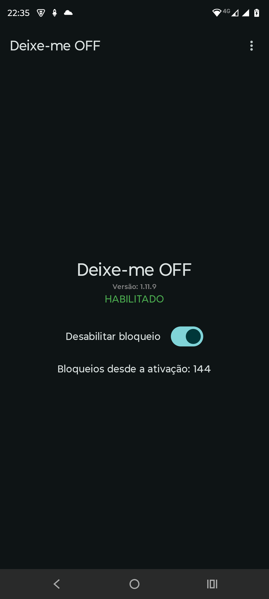
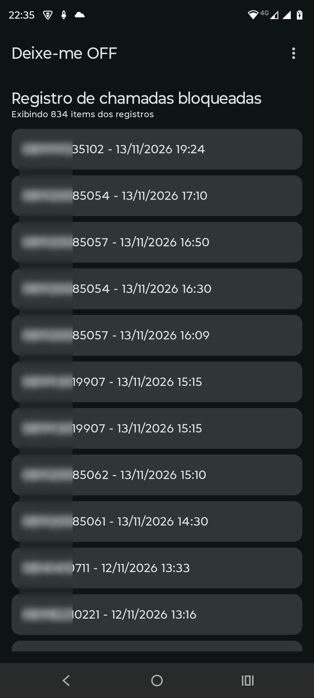
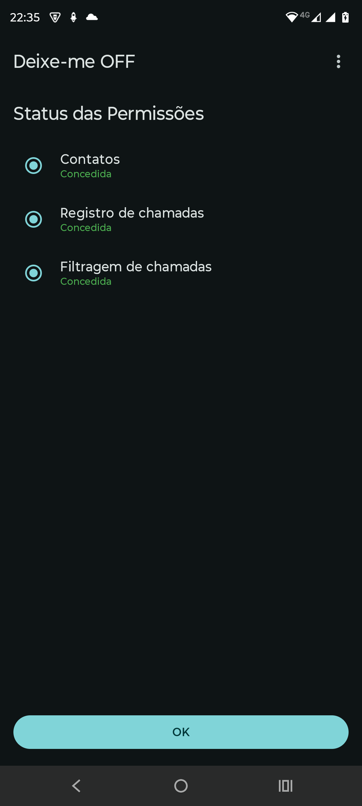

  

<h1 align="center">Deixe-me OFF</h1>

  <b>Simplesmente um bloqueador de chamadas para Android.</b> 
  <i>Não está na sua agenda? Não toca.</i>

  
  
  

---

## 📵 O que é

O **Deixe-me OFF** nasceu de uma necessidade simples: parar de ser interrompido por ligações de telemarketing, golpes e números desconhecidos. Encontrei 2 apps diferentes na PlayStore e não sei por que cargas d'agua, infelizmente, não funcionaram! Então fiz o dmoff.

A ideia é direta: **quando habilitado, o app bloqueia todas as chamadas de números que não estão na sua agenda de contatos.** Quem você conhece continua chegando normalmente; o resto fica de fora, sem toque e sem interrupção. Na tela inicial há um contador de ligações bloqueadas, e pelo histórico de bloquios pode-se aocmpanhar o funcionamento do app.

Sem block lists para manter, sem cadastro, sem anúncios. É só ligar a chave e pronto. Não existe nenhum dado salvo/armazenado fora do smartphone. O app funciona offline.

## ✨ Funcionalidades

| | |
|---|---|
| 🔴 **Um toque para ligar/desligar** | Ative ou desative o bloqueio direto na tela inicial. |
| 📇 **Agenda como lista permitida (allowlist)** | Só tocam as chamadas de quem está nos seus contatos. |
| 🔢 **Comparação inteligente de números** | Contatos salvos com ou sem DDD, `+55` ou outros prefixos são reconhecidos pelos últimos 8 dígitos. |
| 📊 **Contador de bloqueios** | Veja quantas chamadas foram barradas desde a ativação. |
| 🗂️ **Histórico de chamadas bloqueadas** | Consulte o número e o horário de cada chamada barrada. |
| 🔐 **Painel de permissões** | Confira em um só lugar se tudo o que o app precisa foi concedido. |
| 🔒 **Tudo no aparelho** | A filtragem usa a API nativa de triagem de chamadas do Android (`CallScreeningService`). Nenhum dado sai do seu celular. |

## 📱 Telas

  
  &nbsp;&nbsp;
  
  &nbsp;&nbsp;
  

  <b>Início</b> · <b>Histórico de bloqueios</b> · <b>Permissões</b>

## ⚙️ Como funciona

1. Instale o app e conceda as permissões de **Contatos**, **Registro de chamadas** e **Filtragem de chamadas**.
2. Na tela inicial, ative o bloqueio. O status muda para <code>HABILITADO</code>.
3. Toda chamada recebida é comparada com a sua agenda:
   - ✅ **Está nos contatos:** a chamada toca normalmente.
   - ⛔ **Não está:** a chamada é rejeitada silenciosamente e registrada no histórico.

> **Requisitos:** Android 10 (API 29) ou superior.

---

## 🙋 Usuários voluntários...

Caso se interesse em usar/testar/contribuir, precisa fornecer seu email da PlayStore pois ainda está nas fases de testes fechados:

1. Enviar email: **[[LINK DO GOOGLEGROUPS]](https://groups.google.com/g/usuarios-dmoff)**
2. Aceite o convite de teste na Play Store (precisa estar no google groups antes): **[[LINK DE OPT-IN DO TESTE FECHADO]](https://play.google.com/apps/internaltest/4700406798509207687)**
3. Instale o app e pronto!

Ficou com alguma dúvida? Abra uma [issue com o título "Quero testar"](https://github.com/douglasjfm/dmoff/issues/new?title=Quero%20testar). *(Não publique seu e-mail na issue, porque ela é pública.)*

> Qualquer coisa só falar na issue.

---

Contribuições, sugestões e relatos de bugs são bem-vindos.

---

   
  "Feito com ☕ e pouca paciência para telemarketing".

